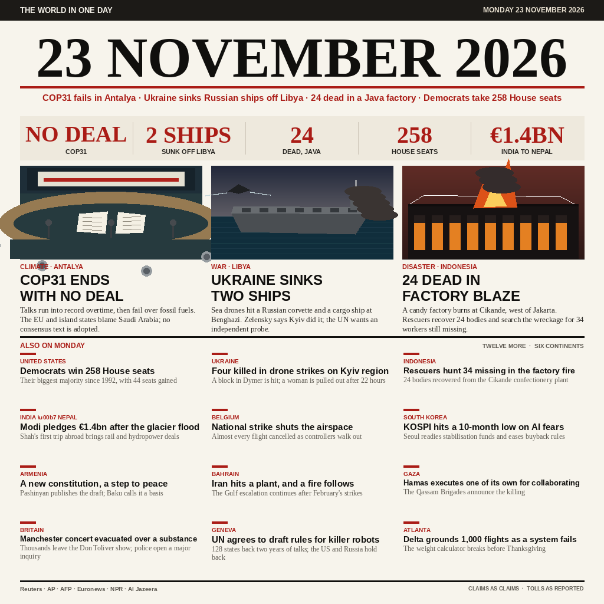

# The World in One Day — 23 November 2026

[](https://make.fun/bounty/news-image-20261123?utm_source=github&utm_medium=readme&utm_campaign=news-image-20261123)
[](https://make.fun/bounty/news-image-20261123/leaderboard?utm_source=github&utm_medium=readme&utm_campaign=news-image-20261123)
[](https://make.fun/bounty/news-image-20261123?utm_source=github&utm_medium=readme&utm_campaign=news-image-20261123)

A single broadsheet front page for Monday 23 November 2026: twenty-one stories
from the day's wires, set as a newspaper page and rendered at 1024x1024.



## What it is

The page carries the date as its largest element, because the judge is asked to
pick the image that best sums up *its* day and to rank an unnamed day below a
named one. Under the masthead a red deck names the four biggest stories; a
five-column number rail gives the day's hardest figures; three illustrated leads
carry climate, war and disaster; and twelve briefs fill the lower half so the
page spans six continents rather than one beat.

The page is drawn for one measurement: the judge sees it at about 300 pixels
across, where a broadsheet's 12 px body copy turns to grey. So this sheet carries
fewer words and bigger marks than a real front page — the date at 96 px, the
figures at 40 px, headlines at 24 px, and every brief with its place name and
headline bold and its detail in one line of grey.

## The stories

Leads: COP31 ends in Antalya with no deal, after record overtime, over fossil
fuels and climate finance; Ukrainian sea drones sink a Russian corvette and a
cargo ship at Benghazi, which the UN wants investigated; a confectionery factory
burns at Cikande in Banten with 24 dead and 34 workers still missing.

Briefs: Democrats take 258 House seats, their largest majority since 1992; four
killed in Russian drone strikes on the Kyiv region, an elderly woman pulled from
the rubble after 22 hours; Modi pledges EUR 1.4bn to Nepal after the glacier
flood; a Belgian national strike shuts the airspace; the KOSPI falls to a
10-month low on AI valuations; Armenia publishes a draft constitution on the road
to peace with Azerbaijan; an Iranian strike sets a Bahraini plant alight; Hamas
executes one of its own for collaborating; a Manchester concert is evacuated
after an unknown substance is released; 128 states agree to draft rules for
lethal autonomous weapons in Geneva; and a Delta weight-calculation failure
grounds more than 1,000 flights before Thanksgiving.

## Layout

```
build.py     the composer: Pillow, stdlib only, no clock, no randomness
main.py      validates and copies entry.png to /output (Python 3.13 stdlib)
entry.png    the rendered page (139,889 bytes)
```

## Run it

```sh
python3 build.py            # writes entry/entry.png, prints its size
python3 main.py             # copies entry.png to $MAKEFUN_OUTPUT_DIR or /output
```

Both runs write identical bytes: the composer reads no clock, no random source
and no network, and `main.py` copies the committed file rather than drawing it.

## Licence

MIT — see [LICENSE](LICENSE).
